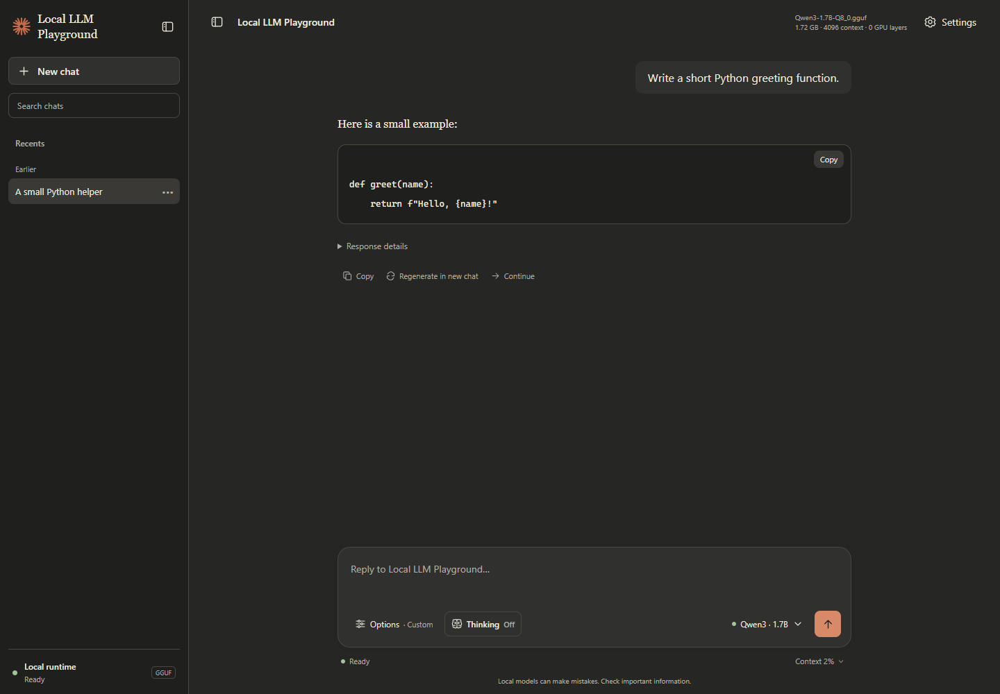

# 🤖 MyLLM

**Version 0.1.10**

A fast, private coding agent optimized for running Qwen Coder GGUF models locally
on Windows.

## 🎯 Built for

- 💻 Developers who want a private coding assistant on their own PC
- 🧪 Model testers comparing GGUF behavior, prompts, thinking, and sampling
- 🪶 Users with modest hardware who need a lightweight local setup
- 🔐 Teams and learners who do not want source code sent to a cloud model

- 🔒 Local and private
- ⚡ Optimized for small Qwen Coder models
- 🧰 Built-in file, search, edit, and verification tools
- 🧠 Optional verified project memory
- 📁 Restricted to the selected workspace
- ↩️ Reversible file operations during the current run

## 🚀 Install

Use 64-bit Python 3.12:

```powershell
py -3.12 -m venv .venv
.venv\Scripts\Activate.ps1
python -m pip install --upgrade pip
python -m pip install -r requirements.txt
```

## ⚡ Quickstart

1. 📦 Place a Qwen Coder `.gguf` model in the `models` folder.
2. ▶️ Start MyLLM:

   ```powershell
   python myllm.py
   ```

3. 🤖 Choose **Model Selection** and select the detected model.
4. 📁 Choose **Project Selection** and select your workspace.
5. 💬 Choose **Chat / Coding Agent** and enter a task.

The model remains loaded while the chat screen is open, making follow-up prompts
faster. Prompt caching can make repeated prefixes and follow-up turns faster too.

## 💬 Local chat only

- 🧼 Chat directly without agent prompts or tools
- 🌊 Stream responses in the terminal
- 🤖 Select a detected model or provide a GGUF path

```powershell
python myllm_local_chat_only.py
python myllm_local_chat_only.py "D:\path\to\model.gguf"
```

- ♻️ `/reset` starts a fresh conversation
- 🚪 `/exit` closes the chat
- 📝 JSONL logs are stored in `model_chat_logs/<date>/`

## 🌐 Local LLM Playground

Run the standalone browser interface for direct model testing—no CLI conversation is required:

```powershell
python local_llm_playground/main.py
```

- 🔎 Discovers GGUF files from `models/`
- ⚡ Automatically loads the last valid model
- 🌐 Opens the browser at `http://127.0.0.1:8000`
- ♻️ Replaces only an older playground instance on port `8000`
- 🛡️ Refuses to stop unrelated applications using that port

Choose **ChatGPT**, **Claude**, or **GitHub Copilot** layouts in light or dark mode, with Local LLM Playground branding. Each theme has its own JSON/CSS configuration for names, wording, logos, colors, and placement.



*Playwright capture of the current frontend with sample conversation data; the displayed metrics are illustrative.*

The interface provides:

- 🤖 Explicit model selection and loading, with visible Thinking support
- ⬇️ Download public GGUF models from Settings, with progress, pause/resume, and explicit loading
- 🌊 Streaming with Stop, Copy, Retry, Regenerate in a new chat, and Continue
- 💭 Collapsed reasoning when returned, plus expandable response details
- 💬 Searchable JSONL history and per-chat drafts restored after refresh
- ⚙️ Grouped response options, per-chat preferences, and explicit saved defaults
- 📚 Saved profiles and prompt templates, starter prompts, an expanded editor, and Edit prompt branches
- 📊 Stored token-usage heatmaps across chats and individual responses
- 📖 Browse other chats during generation; choose reading size, spacing, and send shortcuts
- 📊 Context usage, first-token latency, speed, and token metrics
- 📱 Responsive layouts, keyboard shortcuts, and an always-visible composer
- ♾️ No fixed output-token limit; generation stops at EOS, context boundary, interruption, or error
- 🧼 Direct local chat without agent tools, RAG, project context, or hidden prompts

See the [Playground README and six-theme gallery](local_llm_playground/README.md), [theme customization guide](local_llm_playground/docs/themes.md), and [chat behavior guide](local_llm_playground/docs/usability.md).

Use **Settings → Model loading → Get models** to browse public Hugging Face repositories. See the [model download guide and screenshot](local_llm_playground/docs/model-downloads.md).

## 💡 Example prompts

```text
Inspect this project and explain its entry point. Do not change any files.
```

```text
Create hello.py, verify that it exists, and validate its Python syntax.
```

```text
Find the cause of this error, fix it, and run the available project checks.
```

```text
Search for repeated error handling, explain the duplication, and suggest a simpler design.
```

## ⌨️ Commands

- `/help` — show available commands
- `/back` — return to the main menu
- `Ctrl+C` — interrupt MyLLM

## 🏎️ Recommended low-end settings

- 🧠 **Context:** model selection now applies practical defaults: `4096` for
  FunctionGemma, `8192` for Qwen3 1.7B, `16384` for Qwen3 4B, and `32768` for
  Qwen3.5 9B.
- 🎮 **GPU layers:** `0` with the standard CPU build
- 🔁 **Maximum steps:** `12` for everyday tasks
- 🛑 **No-progress steps:** `3`–`6`
- 🎯 **Temperature:** `0.0` normally; repeated identical failures temporarily raise it up to `0.45`
- 🔍 **Debug:** `0` for quiet output; `1` for the raw model stream
- ⚡ **Prompt cache:** enabled; try `512 MB` on a memory-limited computer
- 📤 **Output limit:** `0` lets the model stop naturally without a fixed token cap
- 📦 **Model:** a 3B–4B `Q4_K_M` GGUF is a practical starting point

Model size and context length have the greatest effect on RAM usage and response
speed. Model profiles are defaults applied on selection; users can change the
values afterward in Settings.

## ✨ Features

- 🧠 Remembers the active project, file, goal, language, and technology across follow-ups
- ⚡ Uses an optional RAM prompt cache to accelerate repeated prompt prefixes
- 🎯 Uses explicit file paths first instead of scanning unrelated projects
- 🧭 Preserves requested languages and frameworks
- 🔎 Detects Node, React, Next.js, Vite, Python, Maven, Gradle, Rust, and Go projects
- 🗺️ Finds the relevant nested project root before running project commands
- ✅ Discovers available test, build, lint, and type-check commands
- 🔄 Re-detects project checks after new project files are created
- 📚 Creates one or many files through a single consistent tool
- 🧾 Requires complete file paths and strict fields in multi-file creation
- ♻️ Treats already-correct file and directory creation as a successful no-op
- 📝 Supports full-file replacement and exact or whitespace-tolerant focused patches
- 📦 Stores large generated content under explicit reusable payload IDs to keep prompts compact
- 🗂️ Tracks created, modified, inspected, and active files
- 🚧 Tracks blockers and unavailable project capabilities
- 🧪 Detects small unfinished stubs and directs the model to implement them
- 🧰 Validates tool names and arguments before execution
- 🔧 Checks whether commands such as `javac` are available without running them
- 📤 Allows unlimited model output by default while retaining an optional limit
- ⚙️ Applies centralized, model-specific context and sampling defaults when a
  model is selected
- 📝 Writes optional timestamped logs for each MyLLM run
- 🧩 Keeps menus, configuration, logging, tools, and agent logic internally separated
- 🔄 Stops repeated actions with a no-progress circuit breaker
- 🌡️ Raises temperature only for repeated identical failures and resets it after progress
- ✂️ Trims old observations while preserving working state
- 🗃️ Saves the complete chat or agent history to a timestamped text file before
  compacting it
- 🕒 Requires a real build, test, type-check, lint, or Python validation after mutations
- 🚧 Records unavailable verification so the agent can report the blocker instead of looping
- ↩️ Can undo file creation, modification, and deletion during the current run
- 🧾 Saves project facts only when backed by successful tool evidence
- 🚫 Rejects fake binary files created through text tools
- 🧱 Blocks file access outside the selected workspace

## 💾 Local data

- ⚙️ Settings: `.myllm/config.json`
- 🧠 Verified project memory: `.myllm/memory`
- 📦 Temporary large-content payloads: `.myllm/payloads`
- 🗃️ Pre-compaction history snapshots: `.myllm/history/<date>/`
- 📝 Timestamped run logs: `myllm_logs/<date>/`
- 💬 Direct model conversation logs: `model_chat_logs/<date>/`
- 🌐 Playground conversations: `local_llm_playground/data/chats/*.jsonl`
- ⚙️ Playground settings: `local_llm_playground/data/config.json`
- 📝 Playground logs: `local_llm_playground/logs/`
- 🤖 Models: `models/*.gguf`

## 🛡️ Safety

- 📁 Tools are restricted to the selected workspace
- 🚪 Paths outside the workspace are blocked
- 🗑️ File deletion inside the workspace does not yet ask for approval
- ↩️ File changes can be undone only during the current run
- 💾 Use version control for important projects
- 👀 Clearly say **do not change files** when requesting a read-only review

## ⚠️ Current limitations

- 🎯 A successful check can validate the latest revision without proving it covered every changed file
- 📚 An unexpected I/O error during multi-file creation may leave a partial batch
- 🔁 Equivalent relative and absolute paths may evade duplicate detection
- 🧩 Mixed-language task constraints may need manual clarification
- 🧪 Stub detection may be too strict for intentionally small source files
- ⏹️ There is no dedicated Stop button
- 💾 A large RAM prompt cache may reduce available memory on low-end computers

## 🕵️ Journey — clues newest first

- **0.1.10 · The Playground Became Easier to Use** — New in 0.1.10:

  - 🎨 **Three customizable themes:** ChatGPT, Claude, and GitHub Copilot layouts,
    each with light, dark, and Follow system appearance.
  - 💭 **Thinking at a glance:** an always-visible control changes color when On
    and shows model compatibility, alongside grouped response options.
  - ⬇️ **Get models from Settings:** browse public Hugging Face repositories and
    download complete single-file GGUFs with progress, pause/resume, cancellation,
    and verification. Choose **Load model** explicitly when the file is ready.
  - 📊 **Stored token usage:** heatmaps across all chats and individual responses,
    with input, output, and total counts that survive restarts and chat deletion.
  - 📚 **Reusable prompts and settings:** saved response profiles, prompt templates,
    starter prompts, and an expanded composer.
  - 💬 **Keep your place:** restored per-chat drafts, edited prompt branches,
    browsing other chats during generation, and reading and send preferences.

  See the [Playground README and screenshots](local_llm_playground/README.md) and
  [model download guide](local_llm_playground/docs/model-downloads.md).

- **0.1.9 · The Playground Opened** — Direct local-model testing gained a responsive
  browser chat, automatic GGUF discovery and loading, JSONL conversation history,
  editable generation settings, streaming metrics, cancellation, and safe port cleanup.
- **0.1.8 · The Tools Became Predictable** — Creation became safely idempotent,
  patches learned deterministic whitespace matching, batch paths became explicit,
  executable discovery gained its own tool, and weak verification stopped trapping
  the agent in repeated checks.
- **0.1.7 · The Trail Became Less Predictable** — A small amount of controlled
  variation helped the coder escape rigid recovery loops without making its tool
  protocol reckless.
- **0.1.6 · The Case Was Filed** — The agent separated its inner machinery,
  began keeping timestamped notes, remembered repeated prompt paths, and stopped
  imposing an output ceiling unless the user requested one.
- **0.1.5 · The Agent Remembered the Case** — Follow-ups retained their target,
  large payloads stopped crowding the prompt, multi-file creation accelerated the
  work, and every new edit reopened verification.
- **0.1.4 · The Agent Found Its Map** — Project detection, hard task constraints,
  working-state tracking, verified memory, undo, and a no-progress escape route
  turned a simple loop into a project-aware investigator.
- **`66ac99e` · The Notebook Appeared** — The once-empty guide finally revealed
  how to summon the agent.
- **`d0bfa35` · The Monolith Split in Two** — Simplicity won: reasoning stayed
  with the agent while focused tools moved behind a cleaner boundary.
- **`7a48927` · The Hidden Room Moved Home** — Configuration and memory began
  following the script instead of the terminal's current directory.
- **`61da581` · The First Voice** — A single script loaded a local model and began
  acting inside a chosen project.
- **`4b40790` · The Ingredients Arrived** — The local runtime dependencies entered
  the scene.
- **`7694b20` · The Empty Room** — One tiny README, one initial commit, and no clue
  yet what the project would become.

## 🏷️ Versioning

- Current development series: `0.1.x`
- Compatible updates increment the patch number: `0.1.9` → `0.1.10`
- Breaking configuration or storage changes may increment the minor version
