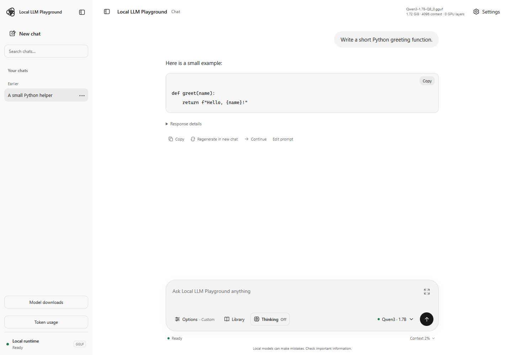
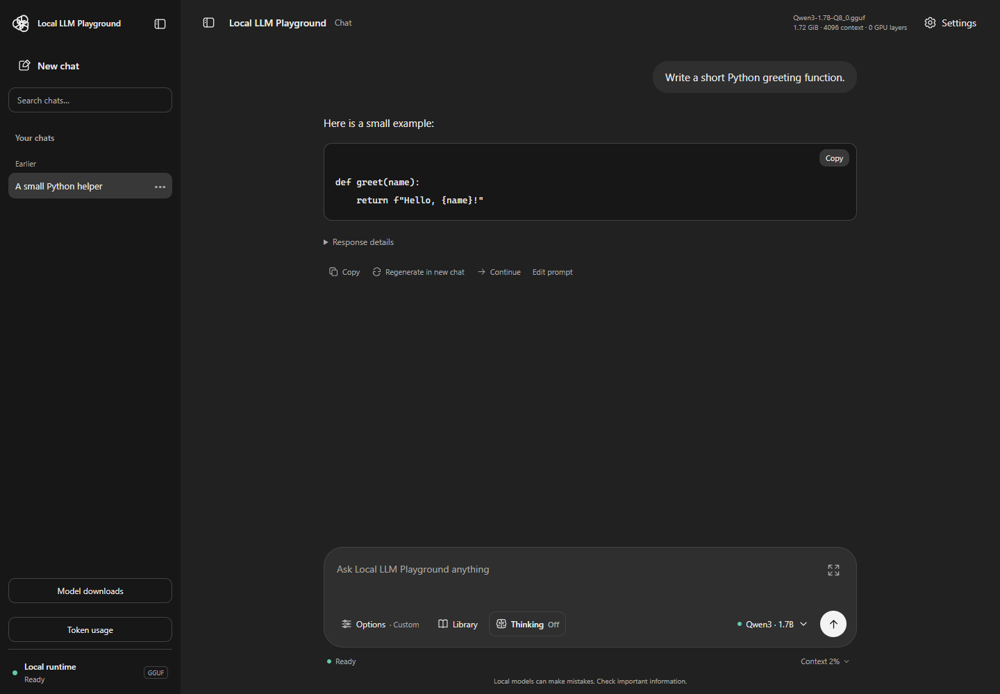
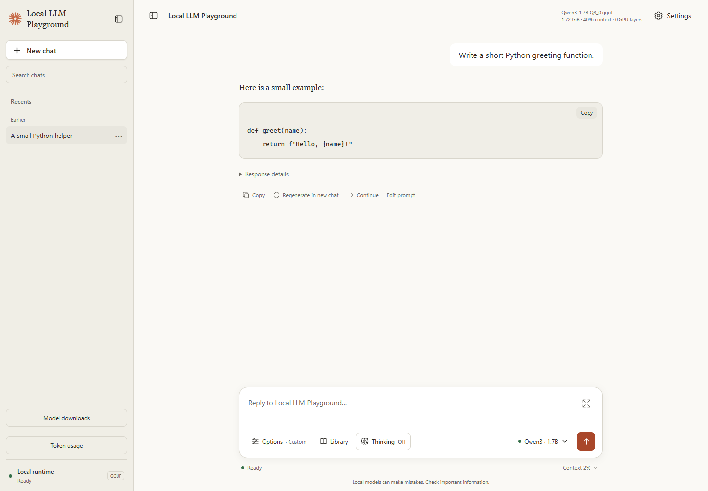
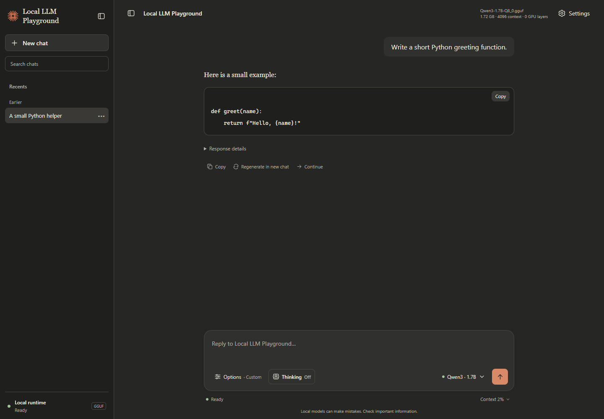
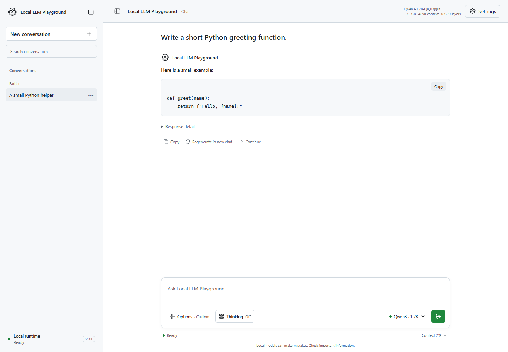
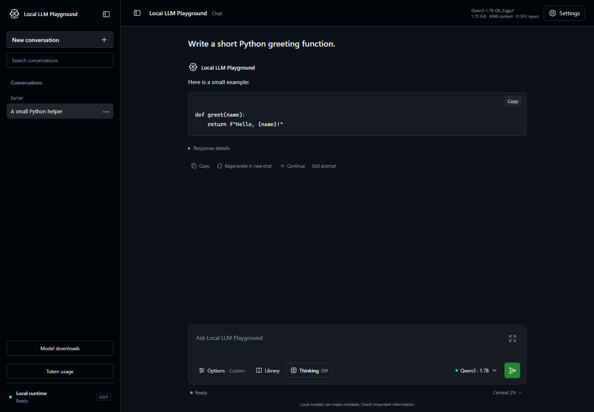

# 🌐 Local LLM Playground

A lightweight browser chat for testing local GGUF models directly.

## Appearance

Open **Settings → Appearance** to choose **ChatGPT**, **Claude**, or **GitHub Copilot**, then **Light** or **Dark**. Each family has its own layout, typography, navigation, composer, and buttons, with Local LLM Playground branding. Choices stay in this browser; switching preserves your draft, conversation, model, and generation settings, including an ongoing response.

Customize each theme's JSON/CSS pair in [`frontend/themes/`](frontend/themes/). See the [customization guide](docs/themes.md) for changing names, logos, wording, colors, fonts, buttons, and supported component positions. These are local recreations of the browser chat styles; they do not add the products' cloud services or agent features.

The composer groups system instructions, temperature, and advanced sampling under **Options**. **Thinking On/Off** stays visible beside it and synchronized with Settings; it applies to the next response on compatible models. The model control shows a shorter name, with the full path in its menu, and the compact context percentage opens detailed usage.

### Screenshots

These Playwright screenshots use deterministic sample conversations and metrics, not a live inference benchmark. They predate the grouped composer controls.

| Theme | Light | Dark |
| --- | --- | --- |
| ChatGPT |  |  |
| Claude |  |  |
| GitHub Copilot |  |  |

## 🎯 Built for

- 🧪 People evaluating model responses and speed
- 🧠 Prompt testers comparing system prompts and thinking modes
- 🌡️ Users tuning temperature and sampling settings
- 🔐 Anyone who wants private, local browser-based conversations
- 🪶 Developers and learners running models on modest hardware

## 🧭 Design

- 🧼 No agent tools, RAG, project context, or hidden prompts
- 🌊 Direct streaming from the selected model
- 💬 Simple ChatGPT-style browser experience

## 🚀 Run

From the repository root:

```powershell
python local_llm_playground/main.py
```

- 🌐 Opens `http://127.0.0.1:8000`
- 🔎 Finds `.gguf` files in the root `models/` folder
- ⚡ Loads the last valid selected model automatically
- 🔄 Switches models beside the prompt without clearing the chat
- ♻️ Replaces an older playground instance on port `8000`
- 🛡️ Never stops an unrelated application using that port

## ✨ Features

- 🤖 Model selector beside the prompt
- 🌊 Streaming responses with **Stop**
- 💭 Expandable **Worked for…** reasoning on every assistant response
- 📋 Copy, Regenerate, and Continue actions
- 💬 Searchable, date-grouped recent chats
- 🧠 Editable system prompt and thinking mode
- 🌡️ Temperature and advanced sampling controls
- 📊 Context use, latency, speed, and token metrics
- ✂️ Safe trimming of older complete turns
- 📱 Responsive layout with an always-visible prompt
- ♾️ No fixed output-token ceiling

- 🛑 Generation ends at EOS, context boundary, error, or **Stop**

## 💾 Storage

- 🤖 Models: `../models/*.gguf`
- 💬 JSONL chats: `data/chats/`
- ⚙️ Settings: `data/config.json`
- 📝 Logs: `logs/`

- 💭 Compatible models receive `/think` or `/no_think`
- 🙈 The thinking directive is not shown in saved user messages

## 🧰 Models not appearing?

- 🔄 Refresh with `Ctrl+F5`
- 📦 Confirm files end in `.gguf`
- 📁 Keep models in the repository's root `models/` folder
