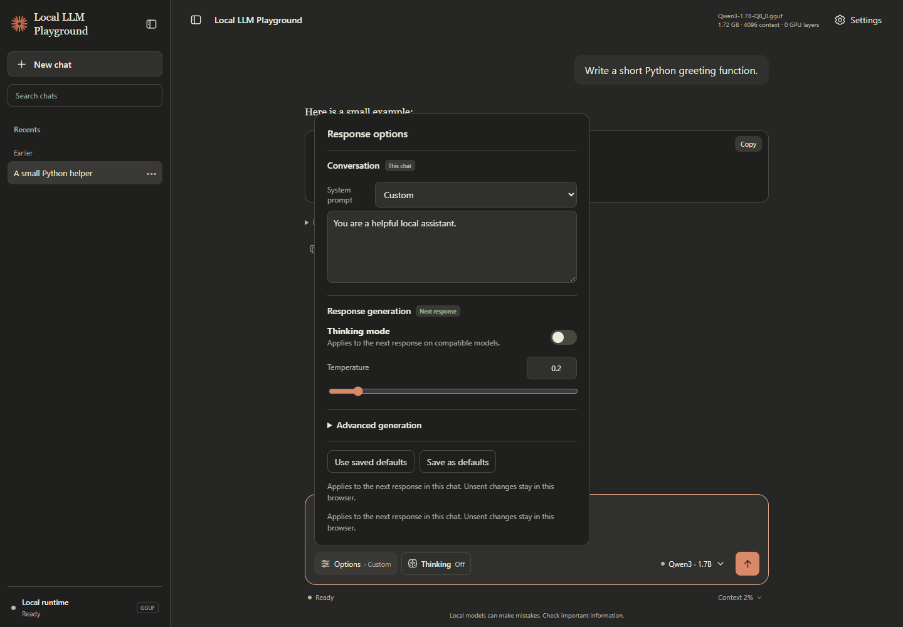
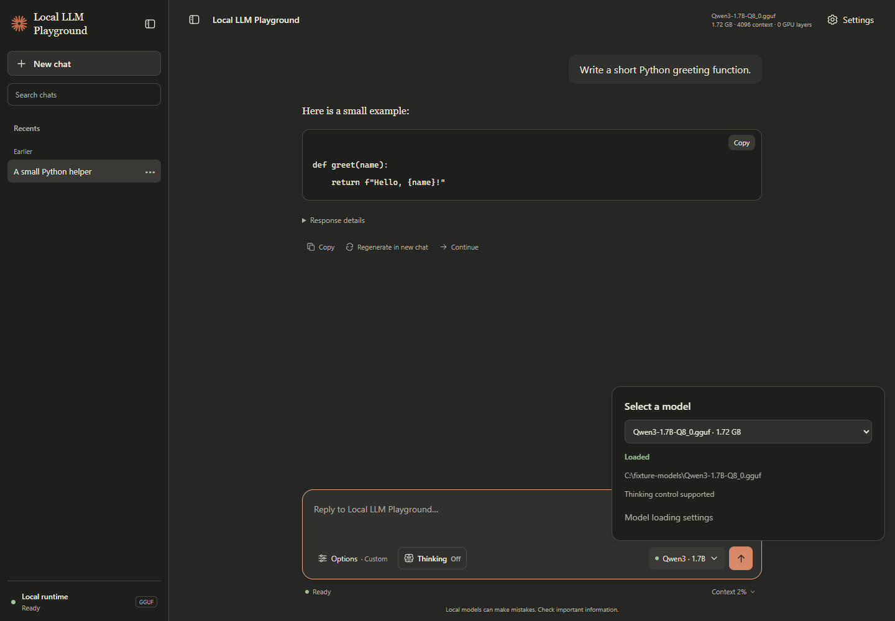
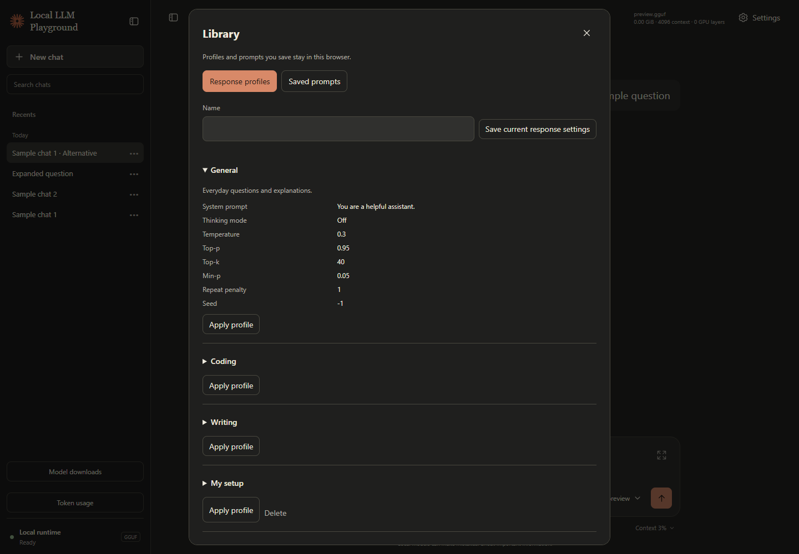
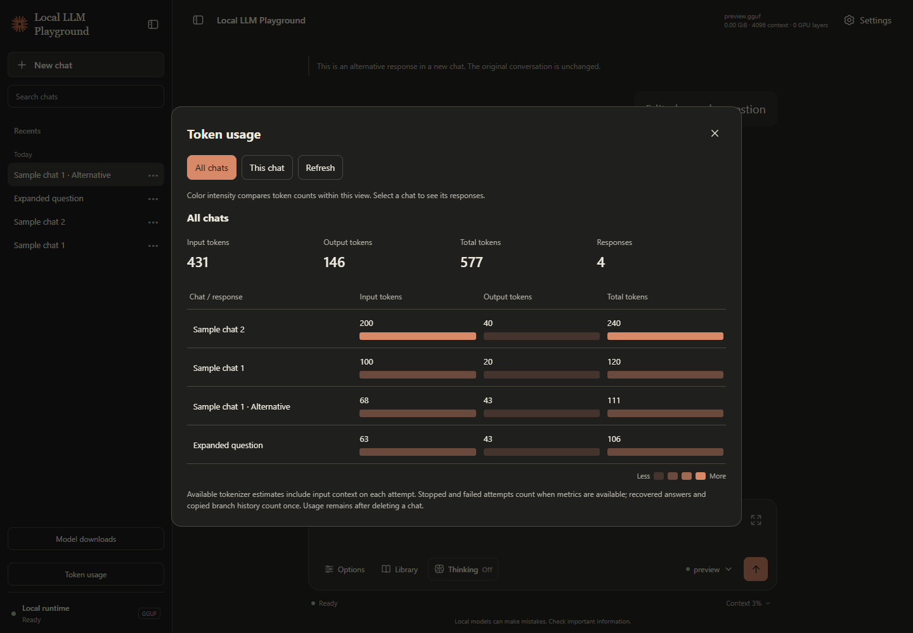

# 🌐 Local LLM Playground

A lightweight browser chat for testing local GGUF models. Compare responses, adjust system instructions and sampling, and inspect performance without agent tools, RAG, or project context.

## 🚀 Run

Install the repository's [Python dependencies](../README.md#-install), then run from the repository root:

```powershell
python local_llm_playground/main.py
```

The launcher opens `http://127.0.0.1:8000`, discovers models, and automatically loads the last valid selection. It replaces an older playground instance on that port and leaves unrelated applications running. To switch models, select one beside the prompt and press **Load**; your conversation and draft stay available.

Add `.gguf` files to the root `models/` folder, or download them using **Settings → Model loading → Get models**.

## Get models

Browse an editable catalog or a public Hugging Face repository directly in Settings. Review GGUF file sizes, choose a filename, and download with progress, Pause, Resume, and Cancel. Downloads continue when the panel closes; interrupted downloads can resume after a server restart. Existing files are preserved, and completed files need an explicit **Load model** action.

Supports public repositories without sign-in and complete single-file GGUF models. Edit [`model_catalog.json`](model_catalog.json) to change the suggestions. See the [download guide and screenshot](docs/model-downloads.md) for storage, verification, and recovery details.

## 🎨 Themes and screenshots

Open **Settings → Appearance** to choose **ChatGPT**, **Claude**, or **GitHub Copilot**, in **Light** or **Dark**. Each family has its own layout, typography, navigation, composer, and button styling, with Local LLM Playground branding. Switching preserves drafts, response preferences, and an ongoing response. Appearance stays in this browser.

These Playwright captures show the current frontend, including grouped **Options**, visible **Thinking**, model readiness, and collapsed response details. Conversations and metrics are deterministic sample data, not live model benchmarks.

| Theme | Light | Dark |
| --- | --- | --- |
| ChatGPT |  |  |
| Claude |  |  |
| GitHub Copilot |  |  |

Customize names, logos, wording, colors, fonts, buttons, and supported component positions in each theme's JSON/CSS pair in [`frontend/themes/`](frontend/themes/). Follow the [theme customization guide](docs/themes.md). These local recreations provide the playground's chat features; product cloud services are outside their scope.

### Composer controls

**Options** groups system instructions, temperature, and advanced sampling. **Thinking** stays visible beside it: supported models show **On/Off**, while unsupported or unconfigured models show **Unavailable** or **Unknown**. Configure compatibility by filename in [`model_capabilities.json`](model_capabilities.json); see the [model state and capability guide](docs/model-capabilities.md).

The model menu separates selection from loading, shows the full path and loaded state, and retains load errors. **Send** becomes available when the selected model is loaded. The compact **Context** percentage opens detailed usage.

While a model is loading, **Cancel load** appears beside the model selector and in **Settings → Model loading**. It stops the model worker and releases its memory without waiting for loading to finish. Once ready, **Unload model** releases the model's memory. Stop an active response before unloading. Chats, drafts, response preferences, downloaded files, and the saved model selection remain available; choose **Load** to use the model again. Refreshing the browser keeps it unloaded for the current server session; restarting the server retains the usual automatic loading behavior.

In **Settings → Model loading**, set **Unload after idle (minutes)** and save the timeout to free model memory automatically. The countdown starts after loading or after the last model request finishes. Use **0** to disable it. An active response can finish before the countdown begins.

| Response options | Model selection |
| --- | --- |
|  |  |

More views: [Claude on mobile](docs/images/themes/claude-dark-mobile.png), [GitHub Copilot on mobile](docs/images/themes/github-copilot-dark-mobile.png), [appearance settings](docs/images/themes/chatgpt-dark-settings.png), and empty chats in [ChatGPT](docs/images/themes/chatgpt-dark-empty.png), [Claude](docs/images/themes/claude-dark-empty.png), and [GitHub Copilot](docs/images/themes/github-copilot-dark-empty.png).

## 💬 Chat behavior

Use the sidebar search to find chat titles or matching messages in the selected folder. Results highlight the matching text. Select a message result to jump to the highlighted message in the conversation. The chat menu can archive a chat or move it to Trash, with **Undo** and **Restore chat** available afterward. Use **Branches** to find related alternatives and jump to their source responses.

**Pin chat** puts the conversation in the Pinned group above recent chats. Use **Bookmark** on a completed answer and open **Bookmarked responses** in the sidebar to jump back to it. Pins and bookmarks are saved with chat backups.

**Export Markdown** downloads the open chat. **Settings → Reading and composing → Chat backups** exports chats, saved prompts, profiles, reading preferences, and appearance as JSON. Restore adds missing chats and Library items. Select the preferences checkbox to restore appearance and reading settings too.

**Settings → Model loading → Model guidance** shows available RAM and disk space and offers CPU starter settings. The RAM comparison uses file size as a rough guide. The model runtime and context use additional memory. See the [GGUF quantization reference](https://huggingface.co/docs/hub/en/gguf#quantization-types) for filename labels such as Q4 and Q8.

**Library** contains reusable response profiles and saved prompts. Start with General, Coding, or Writing, or save the current response settings as your own profile. Profiles apply to the next response in this chat and leave server defaults alone. Prompt templates fill the composer; when a draft exists, choose **Add to draft** or **Replace draft**. Three starter prompts also appear in an empty chat. Custom library items stay in this browser; built-in entries are editable in [`frontend/presets.json`](frontend/presets.json).

Use fields such as `{{language}}` and `{{topic}}` in a saved prompt. When you use it, fill each field once to replace every occurrence before adding the prompt to the composer.

In **Library → Prompt sets**, save an ordered group of up to 20 prompts. **Run in new chat** fills any shared fields and sends the set in order using the loaded model and current response options. Change the model or options and run the same set again for a fresh conversation.

Use the expand icon beside the prompt for a larger editor. It edits the same draft, with **Enter** for line breaks and **Ctrl/Cmd+Enter** to send. **Edit prompt** on a completed response creates a new alternative chat using the revised prompt and that turn's original response settings.

Use the paperclip to preview a UTF-8 text or code file up to 64 KiB and see a rough token estimate. **Add file to draft** inserts the filename and contents as editable text. Open **Context → Preview draft context** for an estimate of the complete request with the loaded model.

You can browse other chats or compose a new draft while a response runs. A banner returns you to the running response; **Stop** still controls it. One response runs at a time. In **Settings → Reading and composing**, choose text size, spacing, and the compact composer's send shortcut. Appearance can also **Follow system**. Response settings have short explanations and individual Reset buttons.

While a response runs, use **Queue prompt** or your send shortcut to add a follow-up in the same chat. Edit, move, or remove waiting prompts above the composer. They send in order with the model and response settings captured when queued. The queue explains why it paused and shows **Resume queue** when a response stops, fails, or the page refreshes. Pending prompts stay in the current browser tab.

These captures use isolated sample chats and fake inference.

| Saved profiles and prompts | Token usage |
| --- | --- |
|  |  |

See the [expanded composer](docs/images/usability/expanded-composer.png) and [chat tools guide](docs/usability.md#library-and-composing).

- **Drafts:** unsent text and response preferences stay with each chat, including an unfinished New chat. Switching chats or refreshing restores them. If browser storage is unavailable, a warning asks you to keep the tab open or copy the text.
- **Recovery:** failed or stopped responses retain partial text. **Retry** reuses the latest attempt's original prompt and settings without duplicating the user message. If the server already completed the answer, Retry recovers it. Earlier attempts remain available after reopening the chat.
- **Alternatives:** **Regenerate in new chat** branches from the selected answer's original prompt and settings, preserving the original conversation. **Continue** adds a visible `Continue.` request after the latest completed answer. These actions preserve a separate composer draft.
- **Compare responses:** load a model and set its response options, then choose **Compare responses** on a completed answer to run the same prompt in an alternative chat. Open the comparison from either answer to see the text, timing, speed, and estimated tokens together.
- **Response details:** reasoning appears when the model returns it. Reasoning and performance sections start collapsed; expand them to inspect timing, speed, token counts, temperature, effective Thinking state, and the model that answered.
- **Context:** with a model loaded and a draft in the composer, open **Context → Preview draft context**. See the messages the model will receive, the estimated input tokens, and how many older messages will be omitted. Generation ends at EOS, the context boundary, an error, or **Stop**.

### Settings scope

| Controls | Applies to |
| --- | --- |
| System instructions, Thinking, temperature, sampling, seed | The next response in this chat; unsent preferences are retained per chat in this browser. |
| **Save as defaults** | Future new chats. Existing chats keep their preferences. |
| **Use saved defaults** | Copies saved response defaults into this chat. |
| Model path, context, GPU layers, threads | The runtime after **Load/Reload**. Pending edits show a Reload state; responses use the loaded settings until it succeeds. |

### Keyboard shortcuts

| Action | Shortcut |
| --- | --- |
| Send | Enter |
| Insert a line break | Shift+Enter |
| Stop a response | Ctrl+Shift+X on Windows/Linux; Cmd+Shift+X on macOS |
| Close a popover or Settings | Escape |

IME composition waits until text is committed before sending. Ctrl+C / Cmd+C keep normal copying behavior. For exact action behavior and manual review scenarios, see the [chat behavior and settings guide](docs/usability.md).

You can change the compact composer to **Ctrl/Cmd+Enter** in Settings; Enter then inserts a line break. The expanded editor always uses Ctrl/Cmd+Enter to send.

## Token usage

Open **Token usage** in the sidebar for totals across all chats, or use **Context → Token usage for this chat**. The heatmap table compares input, output, and total token counts by chat. Select a chat row for its response breakdown, or choose **This chat** for the conversation being viewed.

Usage is stored locally in `data/token_usage.jsonl`, survives restarts, and remains in the overall totals after a chat is deleted. Existing chat metrics are imported when needed. Retries are separate attempts; replaying a saved answer and copying branch history add no new usage. Stopped and failed attempts contribute when counts are available. Counts are tokenizer estimates, and input includes conversation context sent again on each attempt. Older attempts without metrics cannot be reconstructed.

## 💾 Storage

| Data | Location |
| --- | --- |
| Models | Repository root `models/*.gguf` |
| Partial downloads | Repository root `models/.downloads/*.part` |
| Download history | `local_llm_playground/data/downloads.json` |
| JSONL conversations | `local_llm_playground/data/chats/` |
| Saved defaults and model parameters | `local_llm_playground/data/config.json` |
| Token usage ledger | `local_llm_playground/data/token_usage.jsonl` |
| Drafts, unsent response preferences, appearance, last-opened chat | This browser's local storage |
| Custom profiles, saved prompts, reading and send preferences | This browser's local storage |
| Logs | `local_llm_playground/logs/` |

Models explicitly configured as supported receive `/think` or `/no_think`; these directives are hidden from saved user messages. Unconfigured models receive no Thinking directive, and the On/Off preference is retained for supported models.

## 🧰 Troubleshooting

If a model is missing, confirm its filename ends in `.gguf`, place it in the repository's root `models/` folder, and use **Settings → Model loading → Refresh installed models**. You can also download a model with **Get models** or enter a custom GGUF path in Settings. A newly selected model needs **Load** before sending; context, GPU, or thread changes need **Reload**.

When loading fails, the model menu and Settings show the error and a recovery action. Memory errors offer a smaller context, GPU errors offer CPU loading, and file errors offer model downloads. Review the prepared settings, then select **Load model** to retry.

## Verification and screenshot refresh

From the repository root, run the controller and backend checks without a browser or a real model:

```powershell
.\.venv\Scripts\python.exe -m unittest discover -s local_llm_playground/tests -p "test_*.py"
node --test local_llm_playground/tests/recovery.test.cjs
```

These use temporary chats, a fake model, and simulated DOM, storage, and network surfaces. They cover recovery, drafts, model states, keyboard behavior, branches, response presentation, settings scope, validation, and pending reloads.

To check the rendered themes and regenerate the gallery with Playwright, follow the [screenshot instructions](docs/themes.md#playwright-verification-and-screenshots). The preview serves the real frontend with in-memory fixtures and leaves your chats, models, and saved defaults untouched. Review the captures after layout changes and use the [manual scenarios](docs/usability.md#verification) for the complete chat journey.

For end-to-end checks of the new chat tools with temporary data and fake inference:

```powershell
.\.venv\Scripts\python.exe local_llm_playground/scripts/check_usability.py --screenshots
.\.venv\Scripts\python.exe local_llm_playground/scripts/check_downloads.py --screenshots
```
