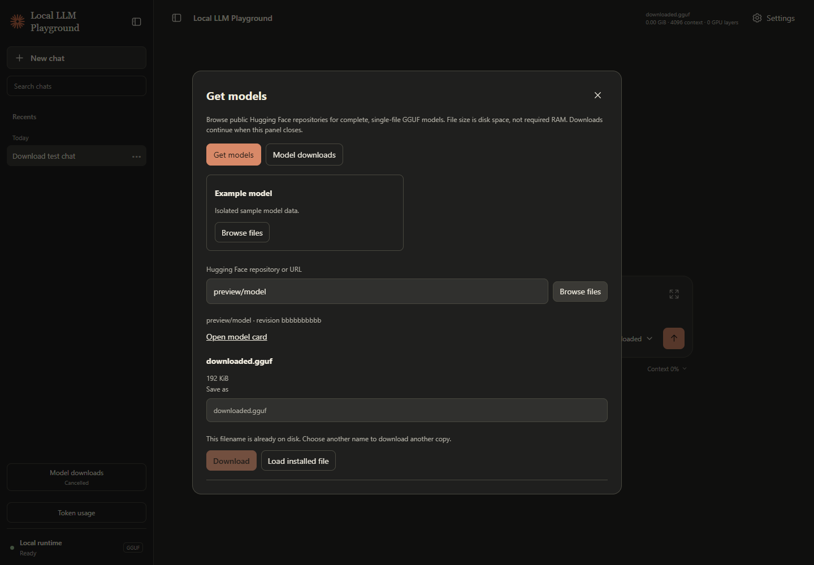

# Get models from Settings

Open **Settings → Model loading → Get models**. Browse a catalog entry or enter a public Hugging Face repository such as `owner/model-GGUF` or its HTTPS URL. Tree/file URLs retain their revision. Opening the app or this panel makes no requests to Hugging Face; **Browse files** retrieves metadata.

Choose a complete GGUF file, review its size and **Save as** filename, then select **Download**. Sizes describe disk space, not required RAM. The model card link opens the publisher's page for model information and terms. Only public repositories that require no sign-in are supported. Split GGUF shards and other weight formats are omitted.



*Playwright capture with a tiny simulated model and isolated sample chat. The catalog and file size shown here are test data.*

## Progress and recovery

**Model downloads** in the sidebar shows progress and opens the download history. One download runs at a time; pause it before starting another. Closing the panel leaves the download running while the server is running.

- **Pause** retains received bytes; **Resume** requests the remainder. If the source cannot resume, the file restarts safely.
- Restarting the server leaves interrupted downloads paused. Open Model downloads and select Resume.
- Connection or disk-space failures retain the partial file where possible. Resolve the problem and use Retry.
- **Cancel download** removes that job's partial file and retains installed models.
- Downloading never overwrites an existing filename. Choose a different Save as name to keep both files.

The selected repository commit is pinned for the whole download. A file appears in `models/` only after its expected size, GGUF header, and SHA-256 checksum (when supplied by the source) pass verification. This checks transfer integrity; runtime compatibility still depends on the model and local hardware.

When ready, choose **Load model** explicitly. This preserves the chat, composer draft, and response defaults. If a response or model load is running, wait until it finishes. **Load installed file** reuses an existing filename; **Refresh installed models** updates the model selectors after files are added manually.

## Configuration and storage

Edit [`model_catalog.json`](../model_catalog.json) to change the suggested repositories, then refresh the browser. Each entry contains `name`, `repo_id`, and `description`. The catalog is a starting point; custom repositories remain available if it is missing or invalid. The bundled entries point to the official [Qwen3 1.7B](https://huggingface.co/Qwen/Qwen3-1.7B-GGUF) and [Qwen3 4B](https://huggingface.co/Qwen/Qwen3-4B-GGUF) repositories; they do not predict whether a model fits your hardware.

| Data | Location |
| --- | --- |
| Completed files | Repository root `models/*.gguf` |
| Partial files | Repository root `models/.downloads/<job-id>.part` |
| Download history | `local_llm_playground/data/downloads.json` |

Partial files and local history are excluded from Git. Keep the history and partial files together to resume after a restart. Downloads do not use stored Hugging Face credentials. Thinking support remains configured by exact filename in [`model_capabilities.json`](../model_capabilities.json); renaming a file can require a matching entry.

## Verification

Run from the repository root after installing Playwright and its browser using the [theme verification instructions](themes.md#playwright-verification-and-screenshots):

```powershell
.\.venv\Scripts\python.exe -m unittest discover -s local_llm_playground/tests -p "test_*.py"
.\.venv\Scripts\python.exe local_llm_playground/scripts/check_downloads.py --screenshots
```

The download journey uses the actual backend/frontend, a fake Hub transport, and tiny temporary files. It checks pause/resume, cancellation, no overwrites, explicit loading, preserved chat/draft/defaults, keyboard focus during polling, and the six theme appearances at desktop/mobile widths. It downloads no real model weights. The service tests also cover failed connections, ignored/invalid resume ranges, checksums, interrupted restarts, disk-space errors, gated repositories, and redirect boundaries.
